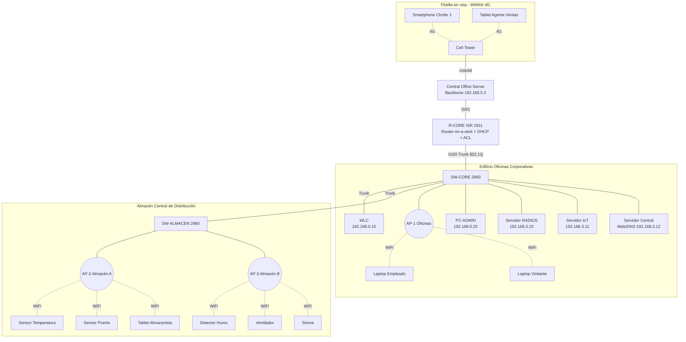

# 1. Diseño y Direccionamiento

## 1.1 Topología lógica

**Idea central:** los 3 Access Points son *lightweight* (LAP). No toman decisiones solos: crean un
túnel **CAPWAP** hacia la **WLC**, y la WLC es quien tiene los SSIDs, la seguridad y el mapeo
SSID → VLAN. Todo el tráfico inalámbrico llega a la WLC y ésta lo entrega al switch por un enlace
troncal, etiquetado con la VLAN que corresponde.

## 1.2 Subneteo de 192.168.0.0/20

- /20 → la máscara es 255.255.240.0 → rango 192.168.0.0 – 192.168.15.255.
- Pasar de /20 a /24 = tomar **4 bits** prestados → 2⁴ = **16 subredes**.
- Cada /24 tiene 2⁸ − 2 = **254 hosts** útiles.

| Subred | Red | Rango útil | Broadcast | Asignación |
|--------|-----|-----------|-----------|------------|
| 0 | 192.168.0.0/24 | .1 – .254 | 192.168.0.255 | VLAN 99 GESTION |
| 1 | 192.168.1.0/24 | .1 – .254 | 192.168.1.255 | VLAN 10 CORPORATIVO |
| 2 | 192.168.2.0/24 | .1 – .254 | 192.168.2.255 | VLAN 20 INVITADOS |
| 3 | 192.168.3.0/24 | .1 – .254 | 192.168.3.255 | VLAN 30 SERVIDORES |
| 4 | 192.168.4.0/24 | .1 – .254 | 192.168.4.255 | VLAN 40 IOT |
| 5 | 192.168.5.0/24 | .1 – .254 | 192.168.5.255 | Enlace Router ↔ Central Office |
| 6 | 192.168.6.0/24 | .1 – .254 | 192.168.6.255 | Red celular 4G (dispositivos móviles) |
| 7–15 | 192.168.7.0 – 192.168.15.0 | — | — | Reservadas para crecimiento |

## 1.3 Tabla de VLANs

| VLAN | Nombre | Puerta de enlace | DHCP | SSID asociado |
|------|--------|------------------|------|---------------|
| 10 | CORPORATIVO | 192.168.1.1 | R-CORE (pool CORPORATIVO) | INNOVA-CORP |
| 20 | INVITADOS | 192.168.2.1 | R-CORE (pool INVITADOS) | INNOVA-GUEST |
| 30 | SERVIDORES | 192.168.3.1 | No (IPs estáticas) | — |
| 40 | IOT | 192.168.4.1 | R-CORE (pool IOT) | INNOVA-IOT |
| 99 | GESTION (nativa) | 192.168.0.1 | R-CORE (pool GESTION, para los APs) | — |

## 1.4 Tabla de direccionamiento

| Dispositivo | Interfaz | Dirección IP | Máscara | Gateway | VLAN |
|-------------|----------|--------------|---------|---------|------|
| R-CORE | G0/0.10 | 192.168.1.1 | 255.255.255.0 | — | 10 |
| R-CORE | G0/0.20 | 192.168.2.1 | 255.255.255.0 | — | 20 |
| R-CORE | G0/0.30 | 192.168.3.1 | 255.255.255.0 | — | 30 |
| R-CORE | G0/0.40 | 192.168.4.1 | 255.255.255.0 | — | 40 |
| R-CORE | G0/0.99 (nativa) | 192.168.0.1 | 255.255.255.0 | — | 99 |
| R-CORE | G0/1 | 192.168.5.1 | 255.255.255.0 | — | — |
| SW-CORE | VLAN 99 | 192.168.0.2 | 255.255.255.0 | 192.168.0.1 | 99 |
| SW-ALMACEN | VLAN 99 | 192.168.0.3 | 255.255.255.0 | 192.168.0.1 | 99 |
| WLC | Management | 192.168.0.10 | 255.255.255.0 | 192.168.0.1 | 99 |
| WLC | Interfaz dinámica CORP | 192.168.1.2 | 255.255.255.0 | 192.168.1.1 | 10 |
| WLC | Interfaz dinámica GUEST | 192.168.2.2 | 255.255.255.0 | 192.168.2.1 | 20 |
| WLC | Interfaz dinámica IOT | 192.168.4.2 | 255.255.255.0 | 192.168.4.1 | 40 |
| AP-1 / AP-2 / AP-3 | G0 | DHCP (192.168.0.21 en adelante) | 255.255.255.0 | 192.168.0.1 | 99 |
| PC-ADMIN | Fa0 | 192.168.0.20 | 255.255.255.0 | 192.168.0.1 | 99 |
| Servidor RADIUS | Fa0 | 192.168.3.10 | 255.255.255.0 | 192.168.3.1 | 30 |
| Servidor IoT | Fa0 | 192.168.3.11 | 255.255.255.0 | 192.168.3.1 | 30 |
| Servidor Central (Web/DNS) | Fa0 | 192.168.3.12 | 255.255.255.0 | 192.168.3.1 | 30 |
| Central Office Server | Backbone | 192.168.5.2 | 255.255.255.0 | 192.168.5.1 | — |
| Smartphones / Tablets 4G | 3G/4G Cell | DHCP (192.168.6.x) | 255.255.255.0 | dada por Central Office | — |
| Laptops corporativas | Wireless0 | DHCP (192.168.1.11+) | 255.255.255.0 | 192.168.1.1 | 10 |
| Laptops visitantes | Wireless0 | DHCP (192.168.2.11+) | 255.255.255.0 | 192.168.2.1 | 20 |
| Sensores/actuadores IoT | Wireless0 | DHCP (192.168.4.11+) | 255.255.255.0 | 192.168.4.1 | 40 |

## 1.5 Tabla de puertos de los switches

**SW-CORE (Oficinas)**

| Puerto | Conecta a | Modo | VLAN |
|--------|-----------|------|------|
| G0/1 | R-CORE G0/0 | Trunk (nativa 99) | 10,20,30,40,99 |
| G0/2 | SW-ALMACEN G0/1 | Trunk (nativa 99) | 10,20,30,40,99 |
| Fa0/1 | WLC (puerto 1) | Trunk (nativa 99) | 10,20,30,40,99 |
| Fa0/2 | AP-1 | Access | 99 |
| Fa0/10 | Servidor RADIUS | Access | 30 |
| Fa0/11 | Servidor IoT | Access | 30 |
| Fa0/12 | Servidor Central | Access | 30 |
| Fa0/20 | PC-ADMIN | Access | 99 |
| Resto | — | shutdown | — |

**SW-ALMACEN**

| Puerto | Conecta a | Modo | VLAN |
|--------|-----------|------|------|
| G0/1 | SW-CORE G0/2 | Trunk (nativa 99) | 10,20,30,40,99 |
| Fa0/1 | AP-2 | Access | 99 |
| Fa0/2 | AP-3 | Access | 99 |
| Fa0/5–Fa0/10 | (Opcional) sensores IoT cableados | Access | 40 |
| Resto | — | shutdown | — |

## 1.6 SSIDs (configurados en la WLC)

| SSID | WLAN ID | Interfaz WLC → VLAN | Seguridad | Usuarios |
|------|---------|---------------------|-----------|----------|
| INNOVA-CORP | 1 | CORP → VLAN 10 | WPA2-Enterprise (802.1X, AES) contra RADIUS 192.168.3.10 | Empleados con usuario y contraseña propios |
| INNOVA-GUEST | 2 | GUEST → VLAN 20 | WPA2-PSK (AES) clave `Visitante2026` | Clientes y proveedores |
| INNOVA-IOT | 3 | IOT → VLAN 40 | WPA2-PSK (AES) clave `SensorIoT2026` | Sensores y actuadores |

## 1.7 Plan de canales (soluciona la interferencia del problema 1)

| AP | Ubicación | Canal 2.4 GHz |
|----|-----------|---------------|
| AP-1 | Oficinas Corporativas | 1 |
| AP-2 | Almacén zona A (recepción/andenes) | 6 |
| AP-3 | Almacén zona B (cámara de insumos médicos) | 11 |

1, 6 y 11 son los únicos canales de 2.4 GHz que **no se traslapan** entre sí. Antes todos los
routers caseros usaban el mismo canal y se interferían.

## 1.8 Cómo resuelve el diseño cada problema

| Problema del caso | Solución |
|-------------------|----------|
| 1. Saturación, interferencia y clave compartida | WLC centralizada, 3 LAPs en canales 1/6/11, ESS con un mismo SSID y roaming; WPA2-Enterprise: cada empleado entra con **su propio usuario**, ya no hay clave compartida. |
| 2. Visitantes en la misma red que los servidores | SSID `INNOVA-GUEST` en VLAN 20 separada + ACL `ACL-INVITADOS` que bloquea todo 192.168.0.0/20. |
| 3. Sin monitoreo ambiental | Sensores de temperatura, puerta y humo registrados en el Servidor IoT, con reglas automáticas que encienden ventilador y sirena. |
| 4. Flotilla desconectada | Torre celular + Central Office Server; los móviles obtienen IP 192.168.6.x y llegan al Servidor Central; la ACL `ACL-CELULAR` sólo les permite llegar al servidor de entregas. |
